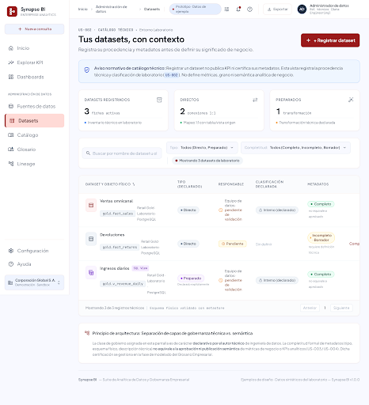
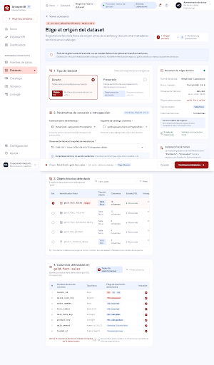
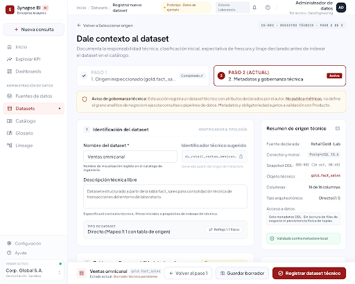
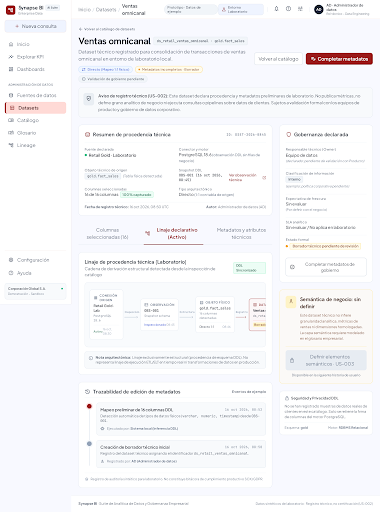

# US-002 — Diseños para revisión

El usuario expresó conformidad con el recorrido local de US-001 y autorizó
generar las pantallas necesarias en Google Stitch. Esto no equivale a aprobación
productiva de US-001 ni a validación de las políticas pendientes de US-002.

Fuente de alcance: [US-002](../../../knowledge-base/requirements/user-stories/US-002-registrar-datasets-y-metadatos.md).
Proyecto: [BI Dashboard with AI — Stitch](https://stitch.withgoogle.com/projects/4378861557064448535).
Sistema reutilizado: Crimson Slate Minimal, `assets/f09737a9c46f4629a3097bc03ec77dc7`.

## Pantallas vigentes

| Pantalla | ID en Stitch | Captura local |
| --- | --- | --- |
| Datasets · Catálogo | `ed659383aece4893a8d32dc692dd3da4` | [Catálogo](assets/catalogo.png) |
| Registrar dataset · Seleccionar origen | `737a3b92c5ae48bf95307229dae906ea` | [Origen](assets/seleccionar-origen.png) |
| Registrar dataset · Metadatos | `7e6873489b214335aa81c7be53720410` | [Metadatos](assets/metadatos.png) |
| Ventas omnicanal · Ficha de dataset | `b848fec1c39348d9ae961a2e409941d2` | [Ficha](assets/ficha-dataset.png) |

Los dos primeros son variantes corregidas: sustituyen los diseños iniciales
`725195c5c57a461d8db992a49f6afc5d` y `ef64675d43b048c0a7ffd9d08a218fd7`.
No usar los iniciales como referencia de implementación: contenían fuentes
Snowflake añadidas por el generador. Las variantes sólo utilizan el laboratorio
PostgreSQL existente. No se modificaron las pantallas de US-001.

## Recorrido propuesto

1. Abrir Datasets o iniciar desde el explorador de una observación de US-001.
2. Declarar tipo Directo/Preparado y seleccionar fuente, observación y objeto.
3. Elegir columnas sin consultar filas de negocio.
4. Completar identificación, responsable, clasificación, expectativa de
   frescura y procedencia. Distinguir siempre declaración de evaluación.
5. Guardar y recuperar la ficha con su referencia a la observación original.

Preparado significa salida existente de una preparación declarada; registrar
no ejecuta pipelines. Ser una vista no implica ser Preparado. El esquema `gold`
no determina automáticamente pertenencia a Medallion. Los metadatos adicionales
de preparación/Medallion se contemplan en secciones condicionales del formulario.

La fecha de observación no representa la última carga. Frescura y calidad se
mantienen sin evaluar; no hay SLA, porcentajes ni certificación inventados.
El registro no define granularidad, dimensiones o KPI y no publica modelos.
Las filas, responsables y clasificación son ejemplos de diseño, no registros
creados en la aplicación ni políticas corporativas aprobadas.

## Decisión confirmada: borradores

**UX-US002-D01 — Confirmada por el usuario el 2026-10-16 en esta conversación.**

Se permite **Guardar borrador** con metadatos incompletos. La interfaz debe
mostrar qué metadatos faltan y distinguir su completitud de la validación o
aprobación del dataset. Guardar no publica ni certifica; el registro no crea
automáticamente KPI, dimensiones ni definiciones semánticas.

Evidencia: el usuario respondió «sí» a la pregunta sobre permitir borradores
incompletos mostrando pendientes y sin considerarlos aprobados. La confirmación
resuelve esa parte de US-002-Q1, no aprueba políticas adicionales ni el diseño
técnico completo de implementación.

La confirmación posterior UX-US002-D02 acepta los mínimos de registro no
borrador de API-002 para el incremento local. Siguen pendientes la taxonomía
empresarial de clasificación, la validación organizacional de responsables y
los objetivos/método de evaluación de frescura (GQ-02). La historia original y
este documento conservan su estado draft; no se declara US-002 implementada.

## Aprobación local del contrato y la persistencia

**UX-US002-D02 — Confirmada por el usuario el 2026-10-16 en esta conversación.**
El usuario respondió «aprobado» a la revisión de API-002 y DM-002 para preparar
el plan de implementación. La aprobación comprende el diseño técnico del
incremento local, incluido el mínimo declarado de responsable, clasificación y
expectativa de frescura para registrar, las condiciones de preparados/Medallion,
la persistencia aditiva y las salvaguardas del contrato. Los borradores pueden
seguir incompletos; registrar no significa aprobar o certificar.

No implica aprobación productiva, una taxonomía empresarial, validación de owners,
objetivos de frescura, aceptación final de US-002 ni elección del método de
ejecución de un plan que todavía debe revisarse. Los documentos conservan draft;
no se añade una verificación humana nominal inexistente.

## Revisión realizada

### Corrección de conformidad visual del catálogo

Para los dos pasos de `/datasets/nuevo`, el usuario confirmó también reproducir
las pantallas de origen y metadatos, conservando dos pasos, clasificación libre
declarada e identificador del sistema. Ver [Conformidad visual del registro](registration-visual-conformance.md).

El 2026-10-17 el usuario autorizó aplicar el diseño Stitch
`725195c5c57a461d8db992a49f6afc5d`, manteniendo registro y completitud separados.
Referencia, implementación, límites y evidencia en
[Conformidad visual de datasets](visual-conformance.md). La conformidad funcional
de US-002 no se reutiliza como aceptación visual de esta corrección.

### Conformidad con la validación local

**UX-US002-D04 — Confirmada por el usuario el 2026-10-16.** Evidencia textual:
«Conforme con validacion de US-002. Continuar con US-003».

Se registra conformidad con la validación del incremento local y autorización
para continuar el trabajo de US-003. No identifica un aprobador organizacional,
no certifica datasets ni aprueba despliegue productivo, políticas empresariales
o reglas semánticas aún pendientes. El aviso preventivo de selección superior
a 500 columnas sigue siendo una mejora menor diferida; la API rechaza el exceso.

La siguiente etapa se delimita en
[RCP-002 — Contexto inicial de US-003](../../../knowledge-base/requirements/context-packs/RCP-002-us-003-definicion-semantica.md).

### Ejecución local autorizada

**UX-US002-D03 — Confirmada por el usuario el 2026-10-16.** Respuesta «si» a
ejecutar aquí el plan de implementación. Método Native/inline; una revisión
independiente del conjunto al cierre. No cambia el gate formal/productivo.

Implementadas las rutas de catálogo, wizard, ficha y edición con API persistente.
La integración con PostgreSQL real verificó 12 tablas y 4 vistas; fact_sales
tiene 16 columnas y 6 FK. El registro reutiliza observaciones sin consultar filas.

Evidencia ejecutada: backend 84 pruebas con PostgreSQL opt-in (83 y una omitida
sin opt-in); frontend 50 pruebas, tipos y build correctos; navegador datasets 3,
fuentes 2, dashboards API 3 y smoke 7, todas pasadas. Axe sin violaciones en
catálogo, origen, metadatos, ficha y edición a 1440/390px; teclado y ausencia de
desbordamiento comprobados. Esto no certifica accesibilidad completa ni producción.
Las capturas de implementación se generan en codebase/test-results/dataset-screens.
La revisión independiente encontró cuatro casos de concurrencia/recuperación;
se corrigieron con regresiones RED→GREEN. Se conserva como mejora menor un aviso
preventivo en UI para selecciones mayores de 500 columnas; la API ya las rechaza.
Los párrafos de revisión visual siguientes describen la fase de diseño anterior.

- Se recuperaron las cuatro pantallas por sus identificadores en Stitch.
- Se inspeccionaron las capturas y el HTML de los formularios.
- Se detectaron y corrigieron referencias no solicitadas a Snowflake y otras
  fuentes; las dos variantes corregidas no contienen esos conectores.
- Se confirmó la presencia de responsable, clasificación, frescura y linaje
  en el formulario, incluidas secciones que requieren desplazamiento vertical.
- No se ejecutó axe ni se certificó accesibilidad del HTML generado. La
  implementación deberá verificar WCAG, teclado, adaptación móvil y estados.
- Esta entrega no modifica código de producto ni implementa la API de datasets.

Stitch propuso como ampliaciones opcionales: búsqueda sin resultados, aviso de
observación histórica, selector completo de 16 columnas, confirmación de registro,
variante de dataset Preparado con referencias de proceso y pestaña de columnas
de la ficha. También sugirió continuar con US-003; queda fuera de este incremento.
La observación técnica se conserva como referencia al recorrido existente de US-001.

## Capturas

### Catálogo

### Selección del origen

### Metadatos

### Ficha

