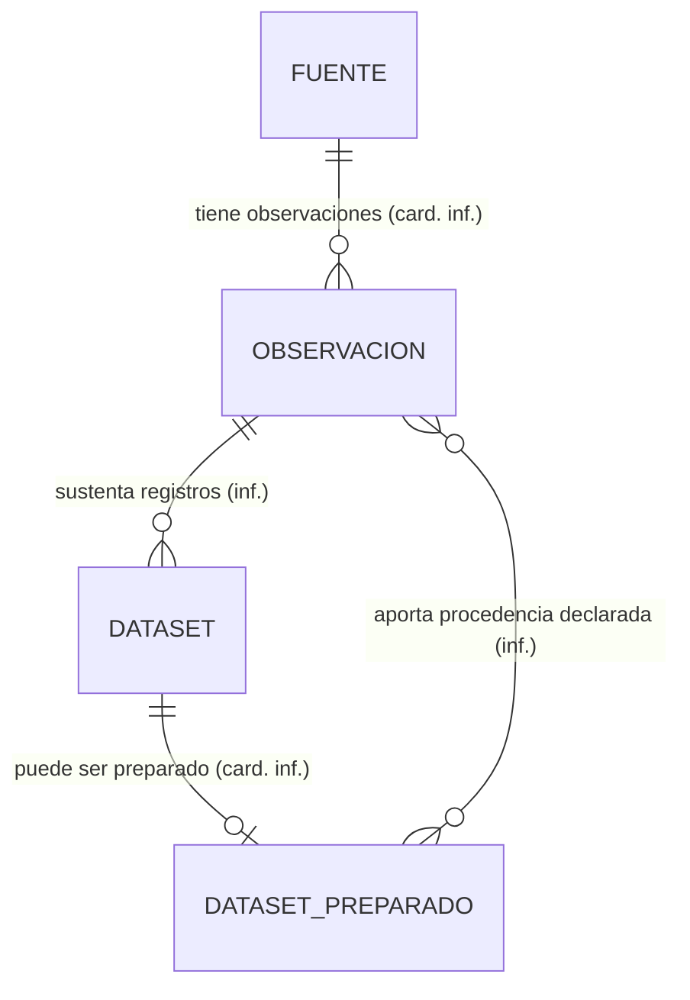

# IMD-001 — Modelo de información conceptual del registro de datasets

> Modelo conceptual del dominio de registro, no del producto completo.
> No define tablas, claves, tipos ni almacenamiento. Las fuentes funcionales
> permanecen en borrador; UX-US002-D01 registra la decisión humana de permitir
> borradores incompletos. Consumidor: diseño de persistencia DM-002.

## 1. Vista general

Una fuente puede observarse para conocer su estructura. Un dataset registrado
conserva su procedencia y metadatos de gobierno. Un dataset preparado es una
especialización de dataset. Registrar no significa preparar, aprobar o publicar.

## 2. Diagrama — Registro y procedencia

**Conceptos derivados:** Linaje de datos, limitado aquí a la procedencia
registrada; se presenta a partir de las relaciones declaradas, sin inferir
transformaciones ni significado de negocio. Completitud es un estado calculado
de la ficha, no una entidad de negocio ni una aprobación.

## 3. Límites y conceptos externos

Los datos de la fuente y la preparación que produce un dataset viven fuera
del registro. No se modela ni ejecuta el proceso de preparación en este bloque.
Responsable, clasificación y expectativa de frescura son información de la
ficha; la autoridad que los valida sigue pendiente en US-002-Q1 y GQ-02.

## 4. Conceptos

| Concepto | Nombre en diagrama | Qué es | Bloque | Glosario | Fuente | Horizonte |
|---|---|---|---|---|---|---|
| Fuente de datos | FUENTE | Concepto observado por US-001; definición pendiente del glosario | Procedencia | Sin término exacto; IM-Q1. No equiparar a Fuente gobernada | US-001 §2 | Primer incremento local (inf.) |
| Observación técnica | OBSERVACION | Concepto registrado por el recorrido de US-001; definición pendiente del glosario | Procedencia | Sin término; IM-Q2 | US-001 AC-1; UX US-002 §Recorrido | Primer incremento local (inf.) |
| Dataset | DATASET | Véase definición del glosario | Registro | [TRM-0005](../glossary/terms/TRM-0005-dataset.md) | US-002 AC-1 | Primer incremento local (inf.) |
| Dataset preparado | DATASET_PREPARADO | Véase definición del glosario | Registro | [TRM-0006](../glossary/terms/TRM-0006-dataset-preparado.md) | US-002 §§2,4 | Primer incremento local (inf.) |
| Linaje de datos | — (derivado) | Véase definición del glosario; proyección parcial en este bloque | Procedencia | [TRM-0016](../glossary/terms/TRM-0016-linaje-de-datos.md) | US-002 AC-1 | Primer incremento local (inf.) |

## 5. Relaciones

| ID | Relación | Cardinalidad | Clasificación | Fuente | Pregunta |
|---|---|---|---|---|---|
| R-01 | Una fuente tiene observaciones técnicas | 1 : 0..N | FACT para existencia; INFERENCE para cardinalidad, porque observar puede repetirse | US-001 AC-1; recorrido local US-001 | IM-Q2 |
| R-02 | Una observación sustenta registros de datasets | 1 : 0..N; cada registro referencia una observación de salida | INFERENCE: reutilizar una misma observación para seleccionar distintos objetos o columnas | UX US-002 §Recorrido propuesto | US-002-Q1: validar alcance de registro |
| R-03 | Un dataset puede ser un dataset preparado | 1 : 0..1 especialización | FACT para especialización; INFERENCE para cardinalidad de clasificación exclusiva | TRM-0005/0006; US-002 §4 | US-002-Q1 |
| R-04 | Observaciones de entrada aportan procedencia declarada a un dataset preparado | 0..N : 0..N | INFERENCE para relación y cardinalidad: la preparación puede declarar múltiples orígenes, pendientes en un borrador | US-002 AC-1; UX US-002 §Recorrido y secciones condicionales | US-002-Q1 |

## 6. Reglas que actúan sobre el modelo

| Regla | Sobre qué concepto | Qué impone |
|---|---|---|
| UX-US002-D01 (decisión, sin BR-*) | Dataset | Permite borrador incompleto, muestra pendientes y no lo considera aprobado |
| US-002:AC-1 (requisito, sin BR-*) | Dataset y Dataset preparado | Asociar responsable, clasificación, frescura y linaje |
| US-001:AC-1 (requisito, sin BR-*) | Observación técnica | Observar estructura no constituye una definición de negocio |

## 7. Preguntas abiertas del modelo

| ID | Pregunta | Afecta a | Responsable | Prioridad |
|---|---|---|---|---|
| IM-Q1 | Incorporar el término Fuente de datos sin confundirlo con Fuente gobernada | FUENTE | af-business-glossary-curator / Producto | Media |
| IM-Q2 | Incorporar Observación técnica y confirmar sus relaciones de procedencia | OBSERVACION, R-01/R-02 | af-business-glossary-curator / Data Engineering | Media |
| US-002-Q1 | Confirmar mínimos del registro no borrador y quién valida metadatos; modalidad borrador ya aceptada | R-02/R-03 y ficha | Producto / Data Governance | Alta |
| GQ-02 | Definir medición y objetivos de frescura | Información de gobierno | Owner / Data Engineering | Alta |

## 8. Historial de cambios del modelo

| Fecha | Cambio | Relaciones o conceptos afectados | Fuente |
|---|---|---|---|
| 2026-10-16 | Modelo inicial del dominio de registro; conserva inferencias y vacíos | R-01 a R-04, cinco conceptos | US-001/002, UX-US002-D01, GLS-001 |

## 9. Preparación y validación

- **Estado:** CONDITIONAL para pasar a data-model-designer como propuesta, no como modelo aprobado.
- **Motivo:** R-02/R-04 y cardinalidades requieren revisión; faltan dos términos exactos.
- **Validación por bloque:**
  - [ ] Procedencia y registro — Producto / Data Engineering — IM-Q1/IM-Q2, US-002-Q1.
- **Inferencias a aceptar o rechazar:** R-02/R-04; cardinalidades de R-01 y R-03.
- Decisión humana de borradores ya registrada en UX-US002-D01; no hay fuentes humanas sin registrar.
- Validación estructural ejecutada: check_model.py informó 4 conceptos en
  diagramas, 4 relaciones, 0 errores y 0 avisos. El quinto concepto de la tabla
  (linaje) es derivado y no un nodo adicional.
- Diagrama renderizado con Mermaid CLI 11 usando Chrome existente: salida SVG
  generada, proceso con código 0. No equivale a validación humana del contenido.
