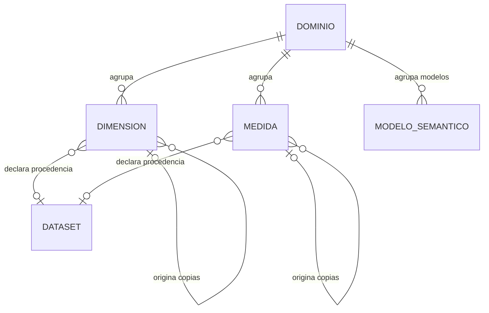

# IMD-002 — Catálogo semántico configurable

Modelo de negocio del catálogo, no modelo de datos. No define tablas, claves,
tipos ni almacenamiento. Consumidores: refinamiento funcional y posterior diseño
de datos. Las decisiones locales D01–D05 están confirmadas, incluidas existencia
y cardinalidad de R-01 a R-08. El diseño escrito completo sigue sujeto a revisión.

## 1. Vista general

Un dominio agrupa dimensiones y medidas reutilizables. Cada componente puede
declarar procedencia en un dataset registrado. Los KPI referencian esos componentes
y documentan significado; si un componente se utiliza, se protege y su cambio se
realiza mediante copia y reasociación explícita (SEM-US003-D03/D04).

Extensión US-004: cada modelo semántico pertenece a un único dominio, que puede
tener varios modelos. Selecciona definiciones KPI del dominio y sus dependencias;
no se crea automáticamente a partir del dominio (GOV004-12). No se diseña aquí
persistencia, composición de versiones ni captura de dependencias.

## 2. Diagrama — Agrupación y procedencia declarada

La procedencia como máximo a un dataset por componente y las cardinalidades de
agrupación/copia fueron aceptadas para este incremento local en SEM-US003-D05.
Los borradores pueden no tener mapeo. Un componente puede originar varias copias;
cada copia tiene un único origen, sin reemplazar al original. Los componentes no
copiados no tienen origen de copia. No es una cardinalidad empresarial universal.

**Derivados y representaciones:** el KPI se representa aquí como definición/vista
de componentes y metadatos, no como nodo adicional del diagrama. Sigue siendo un
artefacto que US-003 debe registrar y editar; no se calcula su valor. Completitud y
linaje son derivados de la documentación y referencias, no entidades adicionales.

## 3. Límites y conceptos externos

Dataset pertenece al registro US-002, documentado en IMD-001; se reutiliza su
procedencia sin convertir el grano físico en significado de negocio. Los valores
de los datos y su cálculo viven fuera del catálogo. Aprobación/publicación del
modelo semántico corresponden a US-004; entidades generales y jerarquías no se
definen en este corte y GQ-03 no se cierra.

## 4. Conceptos

| Concepto | Nombre en diagrama | Qué es | Bloque | Glosario | Fuente | Horizonte |
| --- | --- | --- | --- | --- | --- | --- |
| Dominio | DOMINIO | Véase término del glosario; definición en borrador | Agrupación | [TRM-0024](../glossary/terms/TRM-0024-dominio.md) | SEM-US003-D01/D03/D04/D05 | Primer incremento local |
| Dimensión | DIMENSION | Véase término del glosario | Componentes | [TRM-0007](../glossary/terms/TRM-0007-dimension.md) | SEM-US003-D03/D04 | Primer incremento local |
| Medida | MEDIDA | Véase término del glosario, aún clasificado como inferencia | Componentes | [TRM-0018](../glossary/terms/TRM-0018-medida.md) | SEM-US003-D03/D04 | Primer incremento local |
| Dataset | DATASET | Concepto del registro US-002; véase glosario | Procedencia externa al catálogo semántico | [TRM-0005](../glossary/terms/TRM-0005-dataset.md) | SEM-US003-D01/D04; IMD-001 | Existente |
| KPI | — (representación derivada) | Véase término del glosario; se documenta, no se ejecuta | Definiciones | [TRM-0014](../glossary/terms/TRM-0014-indicador-clave-de-desempeno-kpi.md) | US-003 AC-2; SEM-US003-D02/D03 | Primer incremento local |
| Modelo semántico | MODELO_SEMANTICO | Véase término del glosario; contrato gobernado | Agrupación US-004 | [TRM-0020](../glossary/terms/TRM-0020-modelo-semantico.md) | GOV004-12 / EVD-2026-0016 | Primer incremento US-004 |

## 5. Relaciones

| ID | Relación | Cardinalidad | Clasificación | Fuente | Pregunta |
| --- | --- | --- | --- | --- | --- |
| R-01 | Un dominio agrupa dimensiones | 1 : 0..N | FACT — relación y cardinalidad aceptadas para incremento local | SEM-US003-D03/D04/D05 | IM2-Q2 cerrada |
| R-02 | Un dominio agrupa medidas | 1 : 0..N | FACT — relación y cardinalidad aceptadas para incremento local | SEM-US003-D03/D04/D05 | IM2-Q2 cerrada |
| R-03 | Una dimensión declara procedencia en un dataset | 0..N : 0..1 | FACT — relación y cardinalidad aceptadas para incremento local | SEM-US003-D01/D04/D05 | IM2-Q2 cerrada; detalle SEM-Q05 abierto |
| R-04 | Una medida declara procedencia en un dataset | 0..N : 0..1 | FACT — relación y cardinalidad aceptadas para incremento local | SEM-US003-D01/D04/D05 | IM2-Q2 cerrada; detalle SEM-Q05 abierto |
| R-05 | Una dimensión puede dar lugar a copias independientes | 0..1 : 0..N | FACT — relación y cardinalidad aceptadas para incremento local | SEM-US003-D04/D05 | IM2-Q2 cerrada |
| R-06 | Una medida puede dar lugar a copias independientes | 0..1 : 0..N | FACT — relación y cardinalidad aceptadas para incremento local | SEM-US003-D04/D05 | IM2-Q2 cerrada |
| R-07 | La definición de un KPI referencia dimensiones reutilizables | 0..N : 0..N | FACT — relación y cardinalidad aceptadas para incremento local | SEM-US003-D02/D03/D05 | Cardinalidad resuelta; detalle SEM-Q05 abierto |
| R-08 | La definición de un KPI referencia medidas reutilizables | 0..N : 0..N | FACT — relación y cardinalidad aceptadas para incremento local | SEM-US003-D02/D03/D05 | Cardinalidad resuelta; detalle SEM-Q05 abierto |
| R-09 | Un dominio agrupa modelos semánticos; cada modelo pertenece a un único dominio | 1 : 0..N | FACT — opción A aceptada para primer incremento US-004 | BRC-002 GOV004-12 / EVD-2026-0016 | Resuelta por confirmación A; no implica creación automática |

R-07/R-08 describen la representación derivada del KPI; por eso no agregan nodos
al diagrama conceptual. Referenciar no implica ejecutar ni publicar.
Las cardinalidades antes inferidas pasan a FACT por aceptación explícita D05;
se conserva su procedencia y no se generalizan fuera de este alcance.

## 6. Reglas que actúan sobre el modelo

| Regla | Sobre qué concepto | Qué impone |
| --- | --- | --- |
| SEM-US003-D01 (decisión, sin BR-*) | Dominio y definiciones KPI | Configurables por el usuario; ejemplos no obligatorios |
| SEM-US003-D02 (decisión, sin BR-*) | Definición KPI | Nombre y dominio mínimos; faltantes visibles; no aprobación implícita |
| SEM-US003-D04 (decisión, sin BR-*) | Dominio, Dimensión, Medida | Nombre obligatorio; dimensión/medida requieren dominio; mapeo puede faltar |
| SEM-US003-D04 (decisión, sin BR-*) | Dimensión y Medida utilizadas | No se modifican directamente; copia y actualización explícita de cada KPI |
| SEM-US003-D04 (decisión, sin BR-*) | Referencias declaradas | Deben existir y estar autorizadas, incluso en borrador |
| GOV004-12 | Dominio y modelo semántico | Modelo de un único dominio; varios modelos por dominio; selección de KPI y dependencias sin creación automática |

## 7. Preguntas abiertas del modelo

| ID | Pregunta | Afecta a | Responsable | Prioridad |
| --- | --- | --- | --- | --- |
| IM2-Q1 | Cerrada en SEM-US003-D05: Dominio incorporado como TRM-0024; revisión de definición/responsable sigue en GQ-05 | DOMINIO | Usuario de esta conversación | Media / Cerrada |
| IM2-Q2 | Cerrada en SEM-US003-D05: relaciones y cardinalidades aceptadas; incluye también R-07/R-08 | R-01 a R-08 | Usuario de esta conversación | Alta / Cerrada |
| SEM-Q05 | Precisar mapeos y componentes válidos del primer corte; cardinalidades ya aceptadas en D05, no volver a consultarlas | R-03/04/07/08 | Owner / Data Engineering | Alta / Abierta para detalle |
| GQ-03 | Criterios de entidades de negocio generales | Fuera del primer corte propuesto | Semantic Governance | Pendiente en historia madre |

## 8. Historial de cambios del modelo

| Fecha | Cambio | Relaciones o conceptos afectados | Fuente |
| --- | --- | --- | --- |
| 2026-10-16 | Modelo inicial del catálogo, sin sustituir IMD-001 de registro de datasets | R-01 a R-08; cuatro nodos y representación KPI | SEM-US003-D01–D04 |
| 2026-10-16 | Relaciones/cardinalidades aceptadas; inferencias pasan a FACT local; Dominio incorporado al glosario | R-01 a R-08; DOMINIO / TRM-0024; IM2-Q1/2 cerradas | SEM-US003-D05 |
| 2026-10-17 | Modelo semántico incorporado; agrupación por dominio aceptada | R-09; MODELO_SEMANTICO / TRM-0020 | GOV004-12 / EVD-2026-0016 |

## 9. Preparación y validación

- **Estado:** CONDITIONAL para diseño de datos; no aprobado como modelo empresarial.
- **Motivo:** resta revisar la definición nueva de Dominio/asignar responsable
  (GQ-05) y el detalle funcional de SEM-Q05; Medida conserva su clasificación de
  inferencia en el glosario. Las relaciones/cardinalidades ya no son un pendiente.
- Validación humana por bloque:
  - [x] Agrupación, procedencia, copias y referencias KPI, con cardinalidades R-01 a R-08 — usuario de esta conversación — SEM-US003-D05.
  - [x] Incorporación de Dominio al glosario — IM2-Q1 / SEM-US003-D05.
  - [x] Agrupación dominio/modelo para primer incremento US-004 — R-09 / GOV004-12.
  - [ ] Definición/responsable de Dominio y detalle funcional de mapeos — GQ-05 / SEM-Q05.
- Inferencias de relaciones pendientes de aceptar/rechazar: ninguna en R-01 a R-08.
- Las decisiones humanas usadas están registradas en docs/ux/us-003/decisions.md;
  no hay identidad nominal de verificador inventada.
- Validación estructural anterior US-003 con check_model.py: cuatro conceptos en
  diagramas, ocho relaciones, cero errores y cero avisos. Esto no constituye
  ratificación humana del glosario o diseño; la ratificación de relaciones es D05.
- Render Mermaid pendiente: se intentó con npx --no-install y Chrome. El sandbox
  rechazó el acceso de npm; el reintento autorizado fuera del sandbox confirmó
  que Mermaid CLI 11 no está disponible en caché. No se instalaron dependencias
  nuevas ni se afirma validación visual del diagrama.
- Validación estructural tras R-09: check_model.py → cinco conceptos en diagramas,
  nueve relaciones, cero errores y cero avisos. Mermaid CLI sigue sin instalarse
  localmente; no se afirma render visual del diagrama actualizado.
