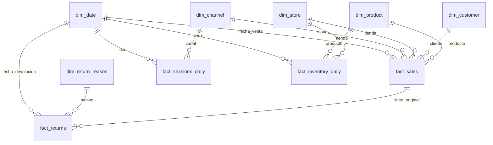

# DM-001 — Retail omnicanal, Gold de laboratorio

## Contexto, alcance y decisiones

El usuario solicitó un Docker Compose con PostgreSQL en su última versión y
propuso tablas de hechos/dimensiones Gold o un caso transaccional alternativo.
Se implementa una fuente Gold local para probar el siguiente incremento de
US-001/002 y el consumo BI. No se implementan todavía conector, ETL, CDC,
registro/publicación semántica ni migración del backend SQLite. No se cambia
el estado propuesto de los ADR ni se certifica el significado de estos KPI.

| ID | Decisión de esta entrega | Procedencia / razón |
| --- | --- | --- |
| DM-D01 | Gold retail primero; OLTP como ampliación posterior | Propuesta del agente dentro de la alternativa Gold solicitada; prioriza validar consumo del recorrido actual. |
| DM-D02 | PostgreSQL 18.6, Compose local, loopback 55432 | PostgreSQL solicitado; versión estable comprobada en la imagen oficial el 2026-10-16. Puerto de laboratorio elegido para evitar el 5432 habitual. |
| DM-D03 | Constelación con cuatro hechos y dimensiones conformadas | Propuesta de modelo de estudio, alineada con ADR-013 propuesto. |
| DM-D04 | Dos tenants sintéticos y FK compuestas | Permite comprobar separación de relaciones y lectura; coherente con límites del PRD. |
| DM-D05 | Login de sólo lectura por tenant y RLS invoker | Propuesta local para verificar accesos sin confiar en filtros aportados por el cliente. No establece tenancy productiva universal. |
| DM-D06 | Ledger de ventas/devoluciones y agregación previa a joins | Evita multiplicación de importes y conserva la fecha del evento. Convención contable del caso, pendiente de validación para un negocio real. |
| DM-D07 | Datos deterministas, sin PII y en PEN | Fixture reproducible; no se infieren monedas, impuestos ni reglas corporativas. |

La guía ejecutable es [`codebase/case-study/README.md`](../../../codebase/case-study/README.md).
Fuentes técnicas: [imagen PostgreSQL oficial](https://hub.docker.com/_/postgres),
[versiones PostgreSQL](https://www.postgresql.org/docs/release/), consultadas el
2026-10-16. Configuración fijada en `postgres:18.6`; volumen en
`/var/lib/postgresql`, conforme a la estructura de la imagen 18+.

## Modelo conceptual

Un tenant posee clientes, productos, tiendas y canales. Un pedido completado
contiene líneas de venta; cada línea referencia producto, cliente, tienda,
canal y fecha. Una línea puede tener varias devoluciones parciales en fechas
distintas. Las sesiones se resumen por día/canal; el inventario es un estado
al cierre del día por producto/tienda. El calendario es compartido.

Las sesiones y los pedidos no son intercambiables. Sólo en el fixture se
supone un pedido por sesión convertida. Los reembolsos no eliminan la venta
original: son hechos separados. El inventario no es un flujo de ventas y no
se suma a través del tiempo.

Las relaciones del diagrama incluyen `tenant_id` cuando ambos extremos son
tenant-scoped. `dim_tenant` es la raíz de pertenencia, omitida en el dibujo
para evitar repetirla en cada arista; las FK están en el DDL.

## Modelo lógico, grano y agregados

| Agregado | Clave / grano | Consistencia |
| --- | --- | --- |
| Línea de venta | tenant/sales_line_key; pedido/línea único por tenant | Sólo pedidos completados; cantidad positiva; descuento dentro del importe bruto. |
| Devolución | tenant/return_line_key, referencia a línea original | Cantidad y valores no negativos; múltiples eventos permitidos. Límites acumulados frente a la venta se comprueban en QA, no mediante trigger. |
| Sesiones | tenant/día/canal | Convertidas entre cero y elegibles. |
| Inventario | tenant/día/tienda/producto | Cantidad no negativa; saldo semi-aditivo. No se modelan movimientos de reposición. |
| Dimensiones | tenant/clave; calendario global por día | Tipo 1; no SCD2 ni cambios históricos en esta versión. |

Un pedido es una dimensión degenerada (`order_number`) del hecho de venta,
no otra tabla de hechos que deba unirse a nivel cabecera. Las dimensiones
de producto/cliente/tienda/canal se conforman entre los hechos relevantes.

## Modelo físico

DDL: [`10-gold-schema.sql`](../../../codebase/case-study/init/10-gold-schema.sql).
Seed: [`20-gold-seed.sql`](../../../codebase/case-study/init/20-gold-seed.sql).
Vistas y permisos: [`30-gold-views.sql`](../../../codebase/case-study/init/30-gold-views.sql).

Hay siete dimensiones (`dim_tenant`, `dim_date`, `dim_product`, `dim_customer`,
`dim_store`, `dim_channel`, `dim_return_reason`), cuatro hechos y un manifiesto
global de inicialización. Importes `numeric(16,2)`, precios/costos unitarios
`numeric(14,2)`, cantidades enteras y fechas con surrogate YYYYMMDD. Importes
bruto, venta e inventario se calculan como columnas generadas para mantener
consistencia. Los costos de venta se conservan en el hecho, sin recalcularlos
desde un precio actual de la dimensión.

PK/unique/FK/checks protegen cada fila y sus relaciones. Índices compuestos
tenant/fecha/canal y tenant/producto/fecha ayudan a los accesos analíticos del
caso. Las devoluciones indexan la línea original y su fecha. No hay particiones
ni materializaciones sin evidencia de volumen que las justifique.

No hay una API de escritura sobre este Gold. El bootstrap carga en
transacciones; el consumidor tiene SELECT. Las comprobaciones de calidad
cruzadas no sustituyen un mecanismo de ingestión validado: cuando éste exista
debe garantizar consistencia entre ventas y devoluciones bajo concurrencia.

## Consumo y reglas de cálculo

`v_revenue_movements` representa importes firmados por fecha del evento:
venta positiva, devolución negativa y reversión de costo negativa.
`v_revenue_daily` agrega por tenant/día/canal/producto. `v_kpi_daily` vuelve a
agregar a día/canal antes de unir sesiones del mismo grano.
`v_inventory_latest` selecciona el último snapshot de cada tenant.

Ingresos netos = ventas brutas − descuentos − reembolsos. Margen =
(ingresos netos − costo neto) / ingresos netos. Conversión = convertidas /
elegibles. Porcentajes se calculan después de sumar componentes y usan NULL
cuando no hay denominador. No hay impuestos, envío, FX ni multi-moneda.
Las devoluciones usan su propia fecha, no la fecha original de la venta.

Estas definiciones de laboratorio requieren aprobación de negocio antes de
convertirse en contratos semánticos. Sus datos no se deben comparar como si
fueran el fixture SQLite de API-001: cambian período, volumen y convenciones.

## Ownership, seguridad y privacidad

Owner técnico: `bi_admin`, sólo bootstrap/administración local. Owners de
negocio reales: pendientes de nombrar. Dos lectores sin privilegios elevados
ni membresías: `bi_reader_global` y `bi_reader_other`. Diez tablas tienen RLS
forzado con tenant fijo según `current_user`; ninguna variable editable del
cliente determina el alcance. Las vistas son `security_invoker=true`.
Calendario y manifiesto son globales sin información de clientes.

Las contraseñas se generan localmente en archivos ignorados por Git y se
montan como secretos Compose; no se imprimen en los comandos de verificación.
Los lectores no tienen CREATE ni escrituras y las sesiones son read-only por
defecto. El backend futuro debe elegir una credencial de origen autorizada a
partir de la identidad del usuario; el conector no debe utilizar `bi_admin`.
Este laboratorio no introduce un pool multitenant productivo.

Datos 100% sintéticos, sin información personal real. Retención es estática
durante la vida del volumen del laboratorio; no se inventa una política legal
ni una retención productiva. TLS, HA, RPO/RTO y backups operacionales no forman
parte de esta topología de desarrollo local.

## Compatibilidad, operación y reversión

Cambio aditivo: nuevo proyecto Compose/volumen y nuevo esquema en una base
independiente; no altera los datos/control plane actuales del backend. Los
scripts init sólo se ejecutan sobre un volumen vacío. Modificarlos no migra
una base existente. Upgrades major requieren una migración planificada.

El puerto sólo se publica en 127.0.0.1; Docker usa el volumen nombrado
`synapse-bi-study_postgres_data`. Stop/down sin eliminación de volumen permite
reversión operativa sin perder datos. No se automatiza una operación de borrado
ni reset. Backups/export y restauración deben diseñarse antes de usar datos
reales o cambiar esquemas. Health comprueba el marcador de inicialización.

## Verificación, trazabilidad y gate

`docker compose run --rm verify` comprueba versión 18.6, conteos, ausencia de
fan-out, conservación de ingresos/costos/sesiones, devoluciones parciales,
último inventario, FK/checks y logins reales de ambos tenants. Se intenta
falsificar `app.tenant_id`, cambiar de rol y escribir: la lectura continúa
aislada y las operaciones no autorizadas se rechazan. Las pruebas no dejan
filas de ensayo.

Resultados verificados del fixture: global 316458.75 PEN netos, otro tenant
632917.50 PEN netos; margen 38.57% y conversión 5.04% en ambos. Los importes
incluyen todos los reembolsos hasta 2026-10-18. Los conteos globales son 2160
ventas, 360 devoluciones, 180 filas de sesiones y 2160 snapshots.

También se recreó únicamente el contenedor PostgreSQL conservando el volumen:
el healthcheck y todas las verificaciones volvieron a pasar con los mismos
conteos/importes. Las consultas de `examples.sql` se ejecutaron bajo el rol
lector Global. Repetir `prepare.py` creó cero secretos y conservó las
contraseñas existentes; los directorios de secretos están ignorados por Git.

La fuente permite probar US-001/002, pero no las marca completas: todavía se
necesitan registro de fuente, secreto gestionado por el backend y observación
de esquema mediante API/UI. Gate `REQUIRES_REVIEW` mantiene explícitas las
decisiones de negocio y operación pendientes. No se declara revisión humana.

## Preguntas y handoff

| ID | Pregunta / siguiente acción | Responsable |
| --- | --- | --- |
| DM-Q01 | Validar fecha contable de devoluciones, costos, impuestos y conversión para el primer dominio real | Producto / owner de dominio. |
| DM-Q02 | Definir ownership, clasificación y frescura del dataset registrado | Data Governance. |
| DM-Q03 | Diseñar almacenamiento/rotación de credenciales de fuente y asociación con tenants de identidad | Backend / Seguridad. |
| DM-Q04 | Implementar un conector PostgreSQL de sólo lectura y observar Gold | Próxima entrega US-001. |

Handoff: README, Compose, DDL/seed, `examples.sql` y pruebas ejecutables en
[`codebase/case-study`](../../../codebase/case-study). Posteriormente se puede
añadir `oltp` y un proceso de preparación sin cambiar el significado acordado
de los modelos semánticos publicados.
